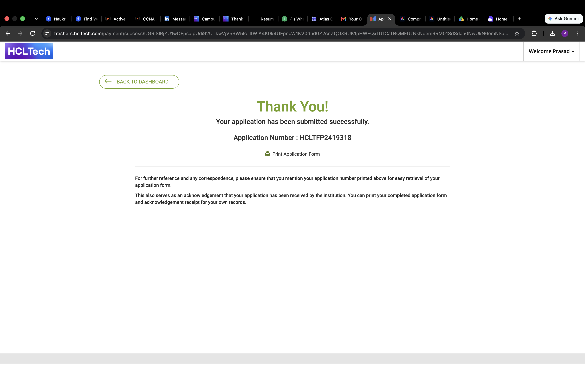

# Phishing Email Analyzer

A beginner Python desktop app that checks sample email text for selected warning phrases and displays a simple risk indicator.

## Features

- Paste email text into the app
- Check for selected urgent wording, sensitive information requests, and payment requests
- Show a risk indicator and any warning categories found

## Run on macOS

You need Python 3.14.

1. Open Terminal.
2. Go to the project folder: `cd ~/Documents/phishing-email-analyzer`
3. Run: `python3.14 analyzer.py`

## Limitations

This project uses simple phrase matching. It can miss phishing emails or flag harmless messages. A LOW result does not mean an email is safe. It does not inspect links, attachments, or sender details.

Use fictional sample emails. Don’t paste private emails or personal information into the project.

## Screenshot

